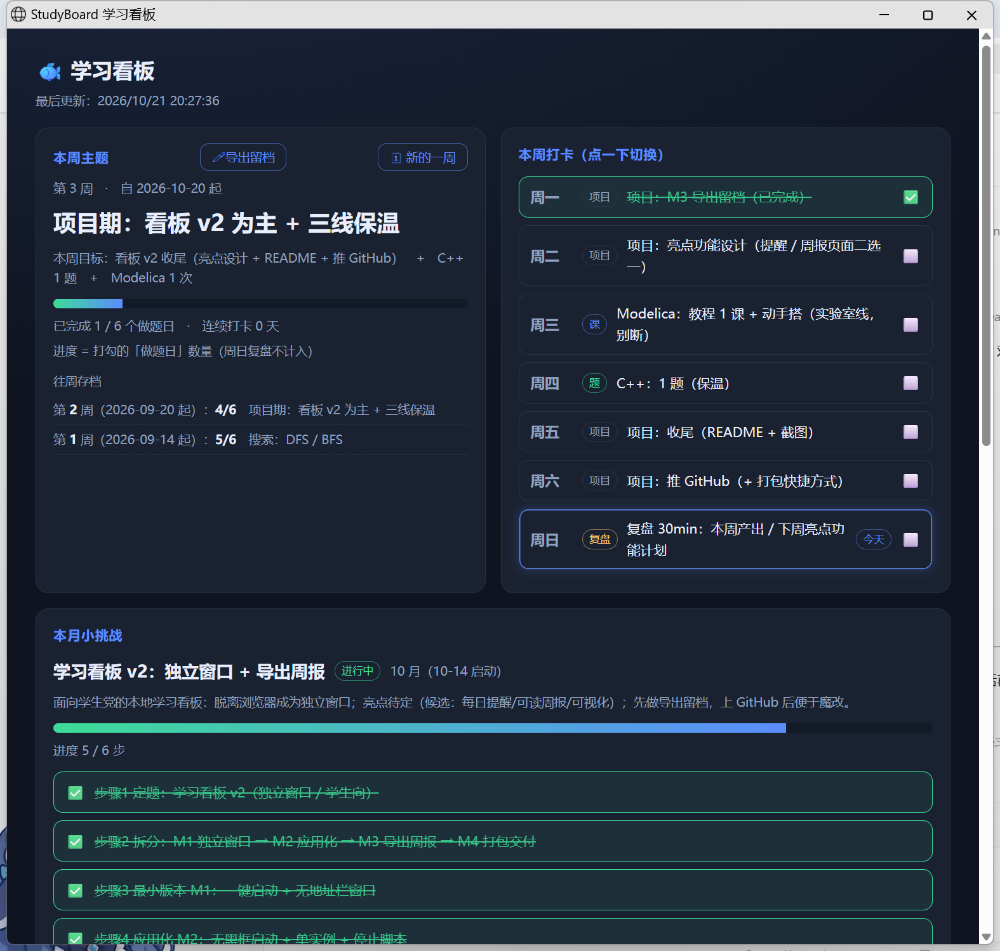

# 🐟 学习看板 · StudyBoard

面向学生党的本地学习看板：**双击即用、不占浏览器、数据全在本地**。

## 功能

- ✅ **周计划打卡**：周一~周日，任务可自定义
- ✅ **连续打卡天数**：由打卡日期自动计算
- ✅ **月度小项目追踪**：步骤 + 进度条
- ✅ **临时任务清单**
- ✅ **保命规则 / 最近记录**
- ✅ **一键导出周报留档**（Markdown，方便备份与迁移）

## 快速开始

1. 装好 [Node.js](https://nodejs.org/)（≥ 18）
2. 双击 `启动看板.vbs` —— 会弹出**无地址栏的独立窗口**
   （首次运行会自动把 `plan.example.json` 复制成你的 `plan.json`）
3. 停止：双击 `停止看板.bat`

> 服务常驻在后台（仅监听 `127.0.0.1:3099`，不对外网开放）。

## 数据说明

| 文件 | 说明 |
|---|---|
| `plan.example.json` | 示例数据（进版本库），第一次运行时自动复制成 `plan.json` |
| `plan.json` | **你的真实数据**（已在 `.gitignore` 中，不会上传） |

改任务/主题：直接编辑 `plan.json`，或点页面上的卡片。

## 文件结构

| 文件 | 作用 |
|---|---|
| `server.js` | 本地 HTTP 服务（零依赖），读写 `plan.json` |
| `dashboard.html` | 页面：卡片渲染 + 导出逻辑 |
| `plan.json` | **唯一数据源**（打卡、项目、记录都在这） |
| `启动看板*.vbs` | 无黑框启动器：检测端口 → 起服务 → 开独立窗口 |
| `停止看板.bat` | 按端口找到进程并停止服务 |

## 设计说明

- **数据 / 逻辑 / 视图三层分离**：`plan.json` → `server.js` → `dashboard.html`
- 页面每 3 秒自动刷新，打钩后立刻可见
- 导出：页面右上「🖊导出留档」→ 下载 `学习看板-第N周-YYYY-MM-DD.md`
- 启动器做了**端口检测**与**单实例**（窗口已开时再双击不会多开）

## 路线图

- [x] 独立窗口（浏览器 app 模式，无需框架）
- [x] 无黑框启动 + 单实例 + 停止脚本
- [x] 周报导出留档（Markdown）
- [ ] 内置周报页面 / 统计页面（打卡日历、完成率趋势）
- [ ] 自动提醒（计划任务 / 托盘图标）
- [ ] 打包为单文件 exe / Electron 壳

## License

MIT
